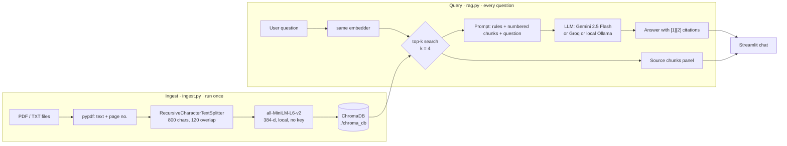

# Mini Project 3 · DocChat — Chat with your documents

A complete, runnable RAG application: drop in PDFs, ask questions, get answers **with citations** to
the exact page they came from. Local embeddings (no key), ChromaDB on disk, and a free-tier LLM.

> **Start with these two documents: your own resume, and a job description you actually want.**
> Then ask *"Which requirements in the JD are not covered by the resume?"* You get a working portfolio
> project and your study plan for the next month out of the same afternoon.

---

## 1. The problem

Every organisation sits on documents nobody can search: a 90-page HR handbook, five years of contracts,
product manuals, insurance policies, RBI circulars. Keyword search fails ("notice period" never appears
— the document says "separation timeline"), and a plain LLM confidently invents answers because it has
never seen these files.

DocChat solves it the way production systems do: index the documents as vectors once, retrieve the few
most relevant passages per question, and force the model to answer **only** from those passages, with
citations a human can verify in five seconds.

## 2. Why this matters for jobs

This is the single most requested GenAI project in 2026 hiring. Search LinkedIn for *GenAI Engineer*,
*LLM Engineer*, *AI Engineer (RAG)* or *Applied AI Engineer* and you will see the same phrases in almost
every posting: **RAG pipelines, vector databases (Chroma/Pinecone/pgvector), LangChain/LlamaIndex,
embedding models, evaluation of LLM outputs**.

Interviewers do not want another Titanic notebook. They want to hear you say: *"I chunked at 800
characters with 15% overlap, measured context recall on a 30-question golden set, added a cross-encoder
re-ranker, and faithfulness went from 0.71 to 0.89."* This project is where you earn that sentence.

**Feeds Capstone 1 — Multi-Agent Enterprise RAG Platform (financial & legal documents).** DocChat is the
single-agent, single-collection version of it. In the capstone you add: one collection per client with
access control, table-aware parsing for financial statements, a router agent that picks the right
collection, a verifier agent that checks every citation, and a LangGraph orchestration layer (Day 41)
over multiple specialised agents (Day 42). Build DocChat well now and the capstone becomes an extension,
not a restart.

## 3. Data

You bring your own — that is the point. Good first documents:

* Your **resume** (PDF) and a **job description** saved as PDF (print the page to PDF from the browser).
* Your college **academic regulations** or an internship offer letter.
* A public document if you want something bigger: any annual report, or the RBI/SEBI circulars, or a
  textbook chapter. Scanned image-only PDFs need OCR first (`pytesseract` or `docling`) — `pypdf` reads
  text layers only.

Nothing is uploaded anywhere except the retrieved chunks that go into the LLM prompt. Use Ollama mode
(below) if even that is not acceptable for your documents.

## 4. Architecture

```
                       INGEST  (run once per document set — ingest.py)
   ┌──────────┐    ┌───────────────┐    ┌────────────────────┐    ┌──────────────┐
   │  PDFs /  │ -> │  pypdf reader │ -> │ Recursive text     │ -> │ MiniLM       │
   │  .txt    │    │  page by page │    │ splitter 800/120   │    │ embeddings   │
   └──────────┘    └───────────────┘    └────────────────────┘    └──────┬───────┘
                                                                         v
                                                             ┌───────────────────────┐
                                                             │ ChromaDB (./chroma_db)│
                                                             │ vector + text + meta  │
                                                             └───────────┬───────────┘
                       QUERY  (every question — rag.py)                  │
   ┌──────────┐    ┌───────────────┐    ┌────────────────────┐           │
   │ question │ -> │ same MiniLM   │ -> │ top-k similarity   │ <─────────┘
   └──────────┘    │ embedder      │    │ search (k = 4)     │
                   └───────────────┘    └─────────┬──────────┘
                                                  v
                        ┌───────────────────────────────────────────┐
                        │ prompt = system rules + [1..k] chunks + Q │
                        └──────────────────┬────────────────────────┘
                                           v
                        ┌──────────────────────────────┐      ┌──────────────────┐
                        │ LLM (Gemini | Groq | Ollama) │ ---> │ answer + [1][2]  │
                        └──────────────────────────────┘      │ + source panel   │
                                    app.py (Streamlit chat UI) └──────────────────┘
```



## 5. Setup

```bash
python -m venv .venv && source .venv/bin/activate     # Windows: .venv\Scripts\activate
pip install -r requirements.txt

# Free LLM key: https://aistudio.google.com/apikey
# Create a .env file in this folder (it is git-ignored) with:
#   GEMINI_API_KEY=your-key-here
# The app loads .env automatically. Groq and Ollama are still available:
#   LLM_BACKEND=groq   + GROQ_API_KEY=...      (https://console.groq.com/keys)
#   LLM_BACKEND=ollama                          (local, no key)

mkdir -p docs && cp ~/Downloads/resume.pdf ~/Downloads/jd.pdf docs/
python ingest.py docs/               # builds ./chroma_db
python rag.py "Which projects mention deployment?"   # quick CLI check
streamlit run app.py                 # the real thing
```

**Fully offline alternative (no key, no data leaves your laptop):**

```bash
ollama pull llama3.2                 # https://ollama.com
export LLM_BACKEND=ollama
streamlit run app.py
```

## 6. Build plan — three sessions

### Session 1 (90 min) — Ingest and retrieve
* Run `ingest.py` on 2–3 documents. Read the printed chunk count and confirm it matches `⌈(N−O)/(S−O)⌉`.
* Run `rag.py --retrieve-only "your question"` and read the chunks. **Do not move on until the right passage is in the top-4** for five different questions. This is the whole project; everything after is presentation.
* Deliverable: a screenshot of a good retrieval and a bad one, and one sentence on why the bad one failed.

### Session 2 (90 min) — Generate and cite
* Wire up the LLM, verify the `[1][2]` markers actually point at the chunks used.
* Test the refusal path: ask something the documents do not contain. If it invents an answer, tighten the system prompt or drop the temperature to 0.
* Run the Streamlit app; add the expandable "Sources" panel; make the file uploader re-ingest on the fly.
* Deliverable: a 20-second screen recording of a cited answer.

### Session 3 (90 min) — Measure and ship
* Write a golden set of 20–30 `(question, ideal answer)` pairs in `eval_set.json`.
* Score it (RAGAS, or the manual faithfulness count = supported claims / total claims).
* Change **one** knob — chunk size, k, or add the cross-encoder re-ranker — and re-measure.
* Deploy free on Streamlit Community Cloud, put the number in the README, post it on LinkedIn.
* Deliverable: a before/after table in your repo README.

## 7. Evaluation

Never claim a RAG system "works" without a number. Build `eval_set.json`:

```json
[{"question": "What is the notice period after confirmation?",
  "ground_truth": "60 days for individual contributors, 90 days for managers.",
  "expected_source": "handbook.pdf"}]
```

Two levels:

* **Cheap (do this always):** *source hit rate* — for how many questions does the correct document appear
  in the top-k? Pure Python, no LLM calls, catches most retrieval bugs.
* **Proper: [RAGAS](https://docs.ragas.io)** — `faithfulness`, `answer_relevancy`, `context_precision`,
  `context_recall`, judged by an LLM. The first two blame your prompt/model, the last two blame your
  chunking and retriever. Run it before and after every change; a change that does not move a metric is
  not an improvement, it is an opinion.

Target for a portfolio project: faithfulness ≥ 0.85 and context recall ≥ 0.8 on 25+ questions. Report
the exact numbers, the model, and the chunk settings — honesty is more impressive than a fake 1.00.

## 8. Stretch goals

1. **Hybrid search** — add BM25 (`rank_bm25`) and fuse the two rankings with Reciprocal Rank Fusion (`k=60`). Fixes queries with invoice numbers, section numbers and product codes.
2. **Cross-encoder re-ranking** — retrieve 30, re-score with `cross-encoder/ms-marco-MiniLM-L-6-v2`, keep 4. Usually the single biggest quality jump.
3. **Multi-document filters** — a sidebar dropdown that restricts search to one file via Chroma's `where={"source": ...}`.
4. **Streaming answers** — `stream=True` on the LLM call, `st.write_stream` in Streamlit. Feels 10× faster.
5. **Conversation memory** — rewrite follow-up questions ("and for managers?") into standalone queries before retrieving.
6. **Table-aware parsing** — swap `pypdf` for [Docling](https://github.com/docling-project/docling) or LlamaParse when documents contain financial tables. This is exactly the Capstone 1 problem.
7. **Guardrails** — refuse questions about documents the user is not allowed to see; log every question, retrieved chunk id and answer to a JSONL file. Your logs become next month's eval set.

## 9. Putting it on your resume and LinkedIn

**Resume bullet (adapt the numbers to your real run):**

> **DocChat — Retrieval-Augmented Document Assistant** · *Python, LangChain, ChromaDB, sentence-transformers, Groq (Llama 3.3), Streamlit*
> Built an end-to-end RAG application over 200+ pages of PDFs: recursive chunking (800/120), local MiniLM embeddings, ChromaDB vector store, top-k retrieval with cross-encoder re-ranking and citation-forced prompting. Evaluated on a 30-question golden set with RAGAS — faithfulness 0.89, context recall 0.84 (up from 0.71 / 0.66 before re-ranking). Deployed on Streamlit Cloud.

**LinkedIn post (three lines + a screenshot or 20s clip):**
1. What it does — "I built a chatbot that answers questions from my own PDFs and cites the page."
2. The stack — "LangChain · ChromaDB · all-MiniLM-L6-v2 · Groq Llama 3.3 · Streamlit."
3. One honest number — "Faithfulness 0.89 on a 30-question eval set; re-ranking added 18 points of context recall."

Tag it with **#RAG #LangChain #VectorDatabase #GenAI**, link the repo, and add *RAG*, *LangChain* and
*Vector Databases* to your LinkedIn skills. Recruiters filter on those exact strings.

## 10. Files

| File | Purpose |
|---|---|
| `ingest.py` | Load PDFs/TXT → chunk → embed → persist to ChromaDB. Run once per document set. |
| `rag.py` | Retrieval + prompt assembly + LLM call with citations. Importable and runnable from the CLI. |
| `app.py` | Streamlit chat UI: upload files, ask questions, expand the source chunks. |
| `requirements.txt` | Pinned-enough dependency list. |
| `.gitignore` | Keeps `chroma_db/`, `docs/` and your `.env` out of git. **Never commit your resume or your API key.** |
